# Walkthrough — SQL Workspace: Wrong and Slow Queries, and How the Platform Catches Them

**Language:** [Bahasa Indonesia](README.md) · English

A query that errors is easy: you notice it. The dangerous ones are queries that **succeed but are
wrong** — their numbers end up in a board slide. This walkthrough runs slow queries and wrong queries
in the Enterprise Data Platform SQL Workspace and shows what the platform catches. The data is
**TPC-H** (the industry-standard benchmark dataset). Every number, warning text, AI answer, and
screenshot below comes from a real run.

> The platform UI in the screenshots is in Indonesian; feature names are given in English below.

## Scenario

**Budi**, a Data Analyst at a fictional retail group, has to prepare a report for tomorrow morning's
board meeting from the `sentosa-dwh` data warehouse (PostgreSQL, already scanned into the Data Catalog,
including primary keys and indexes).

| Table | Rows | Initial indexes |
|---|---|---|
| `orders` | 150,000 | primary key only |
| `lineitem` | 600,572 | primary key |
| `customer` / `part` | 150,000 / 200,000 | primary key |
| `nation` / `region` | 25 / 5 | primary key |

Three layers of safety in the SQL Workspace:

| Layer | Nature | Features |
|---|---|---|
| **Performance hints** | Automatic & deterministic, on every query run | filter without an index, column wrapped in a function, `LIKE '%…'`, impossible filter, JOIN without a condition |
| **On-premise AI** | On request, as suggestions | AI Review (Logic & Structure), Explain in Plain Language, Explain Plan → natural language |
| **Execution evidence** | Facts from the query engine | Query Profile, Explain Plan |

---

## Act 1 — Filtering on a Column Without an Index

```sql
SELECT orderkey, orderdate, totalprice
FROM sentosa_dwh.public.orders
WHERE custkey = 34;
```

The result comes back (4 rows), with a **Performance hint**:

> Filter on orders.custkey has no supporting index — this may cause a full table scan on large tables.

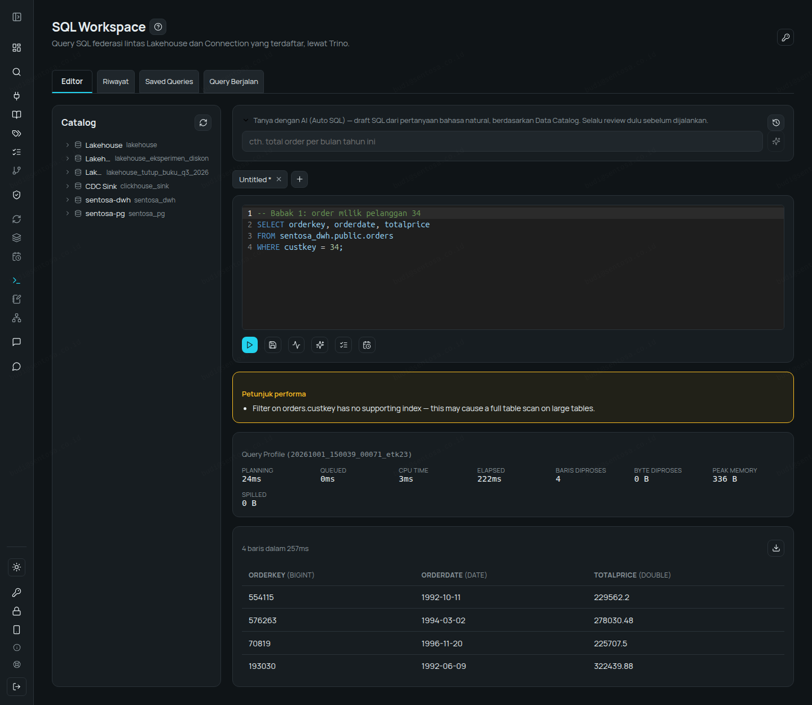

The platform reads the **actual** indexes from the source database through the Data Catalog — the
warning is specific to the table and column. The DBA creates indexes at the source, then the
connection is rescanned:

```sql
CREATE INDEX idx_orders_custkey ON orders(custkey);
CREATE INDEX idx_orders_orderdate ON orders(orderdate);
```

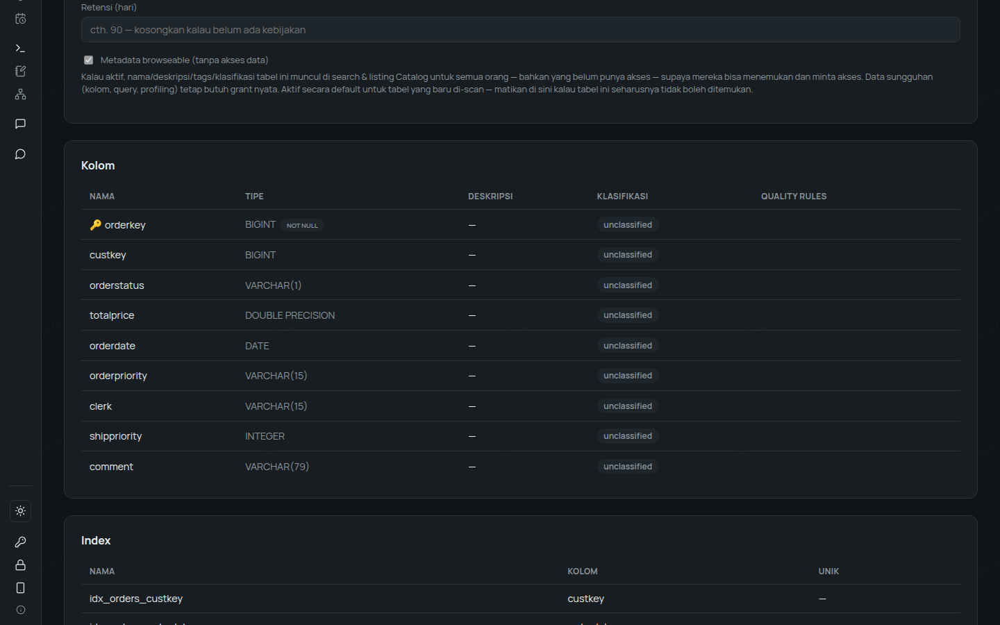

The same query is run again — the warning is gone.

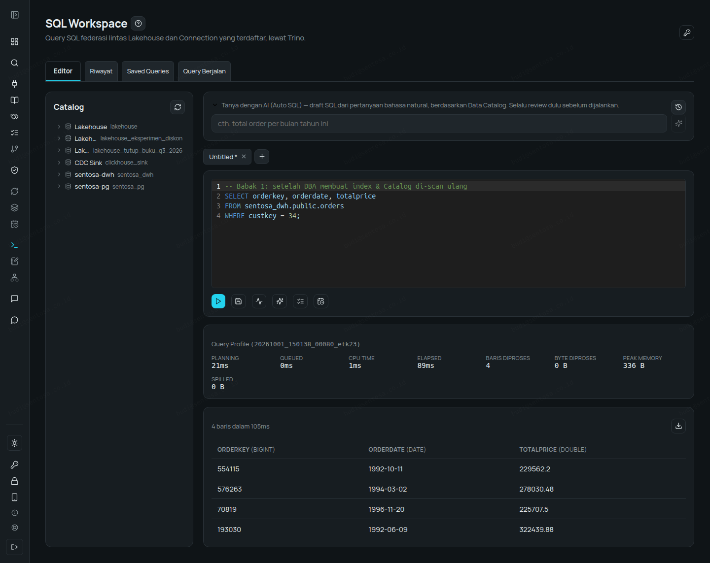

## Act 2 — The Index Exists, but Isn't Used

```sql
SELECT orderkey, custkey, totalprice
FROM sentosa_dwh.public.orders
WHERE year(orderdate) = 1997;
```

22,682 rows, and:

> Filter on orders.orderdate wraps the column in a function/expression — this prevents an index from being used even if one exists.

The `orderdate` index was just created — but this query can't use it.

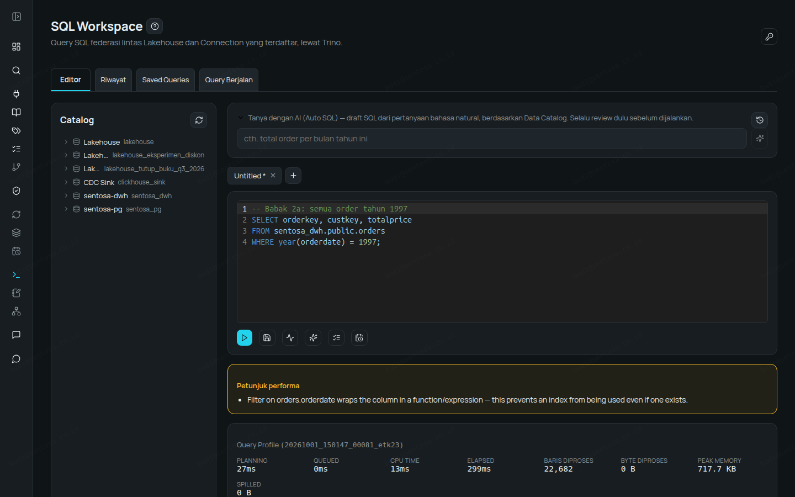

The correct version uses a date range: exactly the same result (22,682 rows), with no warning.

```sql
SELECT orderkey, custkey, totalprice
FROM sentosa_dwh.public.orders
WHERE orderdate >= DATE '1997-01-01' AND orderdate < DATE '1998-01-01';
```

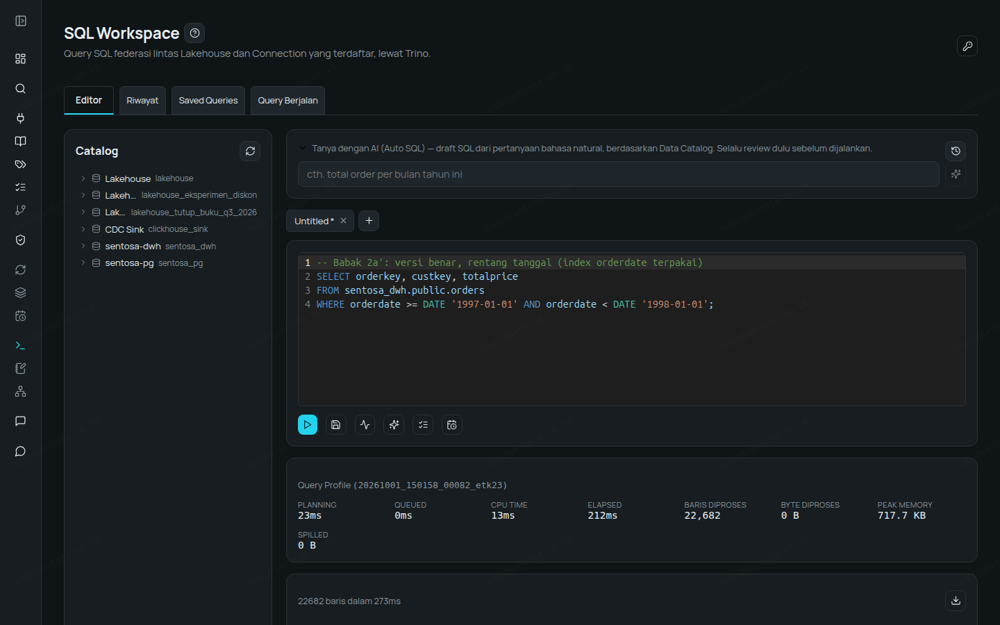

`LIKE` with a leading wildcard is caught too:

```sql
SELECT partkey, type, retailprice
FROM sentosa_dwh.public.part
WHERE type LIKE '%BRASS';
```

> Filter on part.type uses LIKE with a leading '%' — this can't use a standard index and forces a full scan.


## Act 3 — Wrong but "Successful"

```sql
SELECT orderkey, totalprice
FROM sentosa_dwh.public.orders
WHERE totalprice > 300000 AND totalprice < 50000;
```

0 rows, **no error** — and:

> Filters on totalprice contradict each other (> 300000, < 50000) — no row can satisfy all of them, this WHERE condition always returns zero rows.

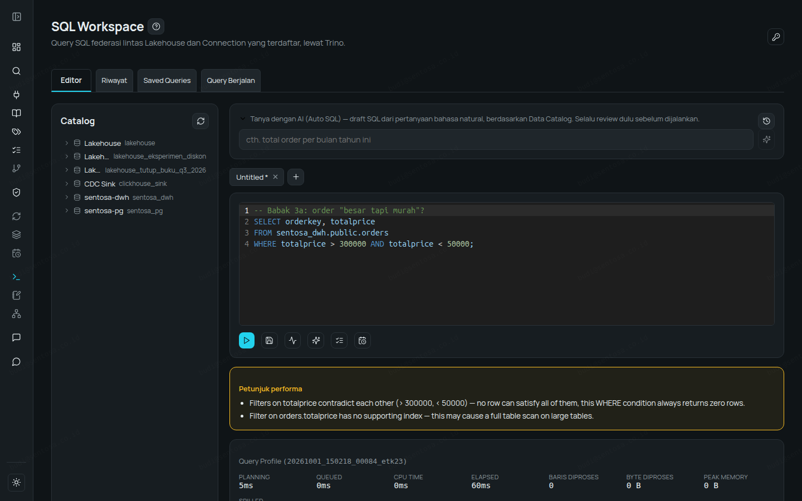

```sql
-- how many nation–region pairs? (should be 25: each nation belongs to 1 region)
SELECT count(*) AS jumlah_baris
FROM sentosa_dwh.public.nation n, sentosa_dwh.public.region r;
```

The result is **125** — 25 nations × 5 regions, because the JOIN condition was forgotten:

> Join to r has no ON/USING condition — every row is matched with every row on the other side (a cartesian product), which is almost always a missing join condition rather than intentional.

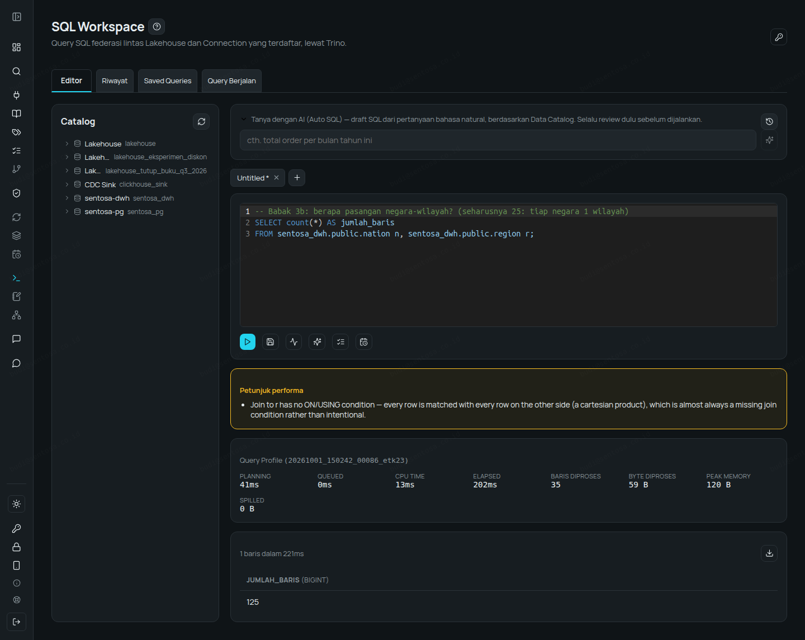

## Act 4 — Logic Errors That Need a "Second Pair of Eyes"

Some bugs are structurally valid, so deterministic rules can't catch them. This is where **AI Review**
(an on-premise AI model) helps.

```sql
-- total order value for customer 34
SELECT o.custkey, SUM(o.totalprice) AS revenue
FROM sentosa_dwh.public.orders o
JOIN sentosa_dwh.public.lineitem l ON l.orderkey = o.orderkey
WHERE o.custkey = 34
GROUP BY o.custkey;
```

Revenue: **6,479,641**. No warning. Click **AI Review (Logic & Structure)**:

> The join with `lineitem` is unnecessary and causes the result to be incorrect: it multiplies the order total (`o.totalprice`) by the number of line items (since each order is repeated per line item), inflating the revenue value.

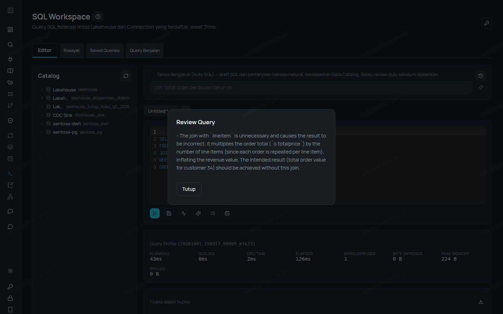

Without the `lineitem` JOIN: **1,055,740**. The first figure is **6× too large** (4 orders, 24 line
items).

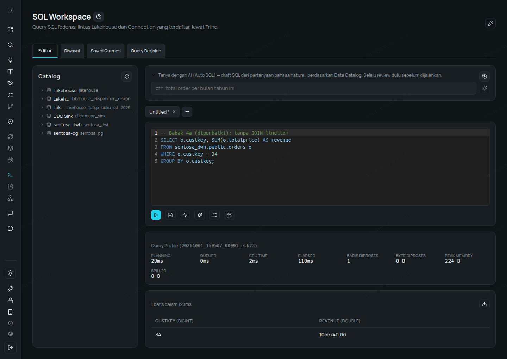

A second example — `AND`/`OR` precedence:

```sql
-- orders with status F or O whose value is > 300,000
SELECT count(*) AS order_besar
FROM sentosa_dwh.public.orders
WHERE orderstatus = 'F' OR orderstatus = 'O' AND totalprice > 300000;
```

Result: **77,107**. AI Review:

> Logical error: The `WHERE` clause condition is interpreted as `(orderstatus = 'F') OR (orderstatus = 'O' AND totalprice > 300000)` due to SQL operator precedence (AND binds tighter than OR)… The intended meaning requires parentheses: `(orderstatus = 'F' OR orderstatus = 'O') AND totalprice > 300000`.

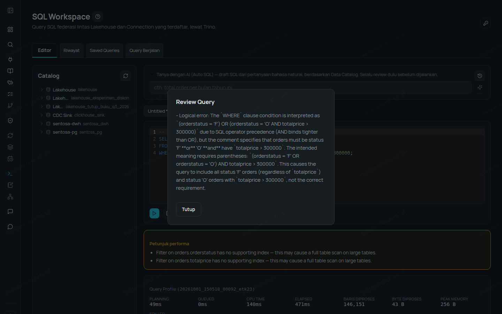

With parentheses: **8,343** — the first figure was 9× too large.

Deterministic rules only report what is certain; AI Review suggests fixes for patterns that require
understanding intent — flagged as suggestions, not verdicts.

## Act 5 — Understanding Inherited Queries

Budi inherits an undocumented query (TPC-H Q3). **Explain in Plain Language (AI)**:

> This query finds the **top 10 highest-revenue orders** for customers in the "BUILDING" market segment that were **ordered before March 15, 1995** but **shipped after March 15, 1995**.

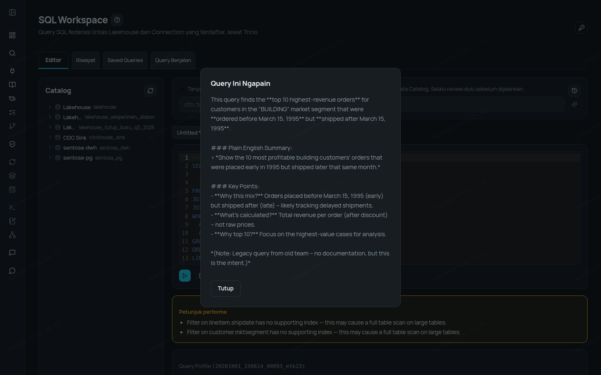

**Explain** shows the real plan from the query engine, and **Explain in natural language** summarises
it: which tables are read, which filters are pushed down to the source, the JOIN order, about 93
thousand rows processed, no expensive operations — with the note "generated by an on-premise AI
model… as guidance, not a guarantee".

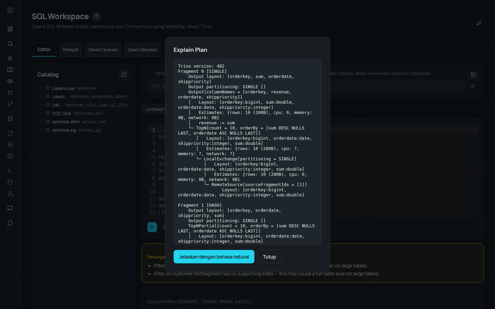
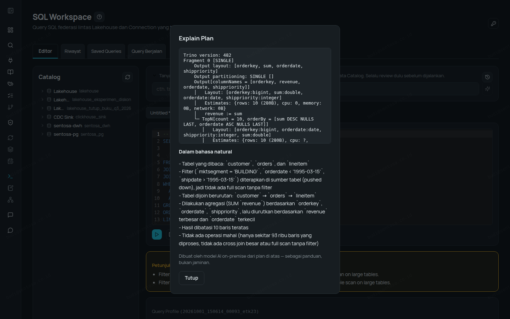

## Act 6 — Making It a Team Asset

The corrected query is saved to **Saved Queries** and shared with the team; **History** records every
execution (time, status, duration, row count).

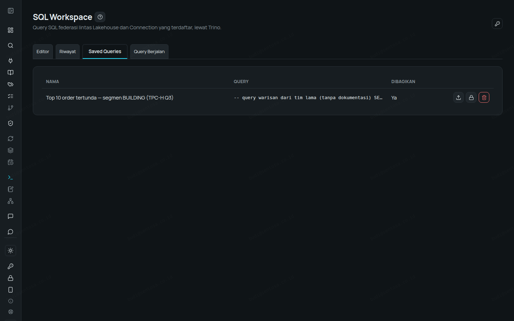
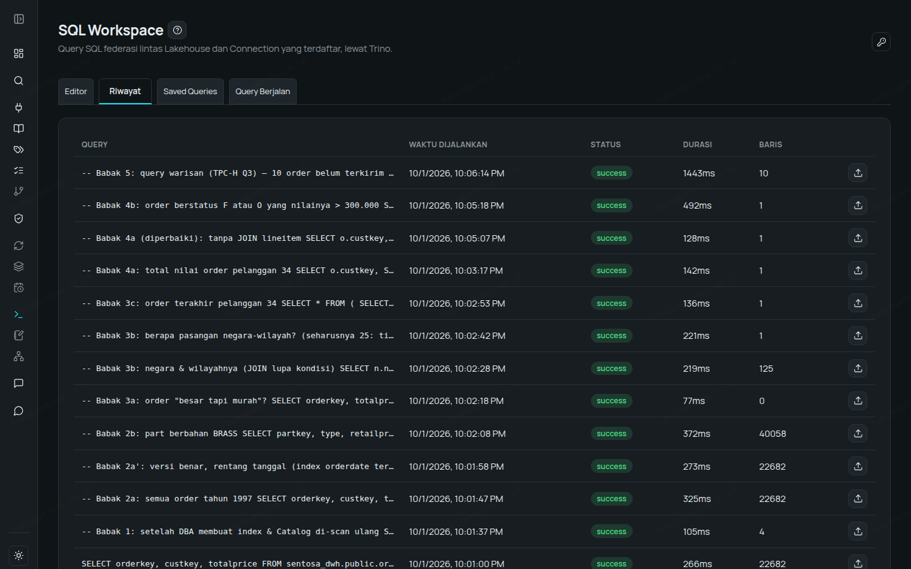

---

## Summary

| Problem | Caught by | Evidence |
|---|---|---|
| Filter without an index | Performance hint | warning disappears after the index is created |
| Index exists but isn't used (`year()`, `LIKE '%…'`) | Performance hint | same result, no warning |
| Impossible filter | Performance hint | 0 rows with no error |
| JOIN without a condition | Performance hint | 125 rows instead of 25 |
| Fan-out JOIN | AI Review | 6× too large |
| AND/OR precedence | AI Review | 9× too large |
| Not understanding a query / plan | Explain (AI), Explain Plan + natural language | — |

All AI in this walkthrough runs **on-premise** — queries and metadata are never sent to a public AI
service. Masking and access rights still apply to every query.

**Free trial, no sales call:** https://alzizan.co.id/register

**Want to see it with your team's use case?** Request a demo, or a free in-house *Big Data & AI Tech Update* session at your office: sales@alzizan.co.id
